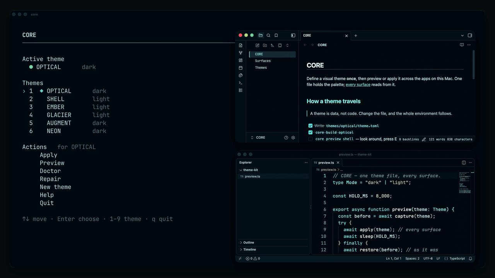
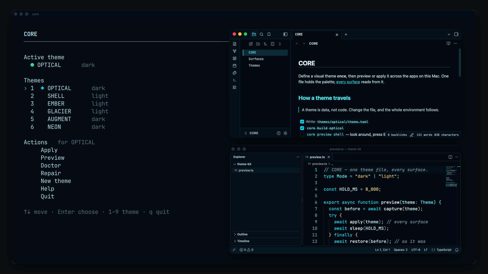
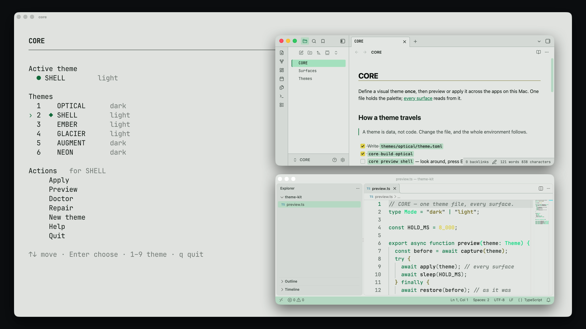
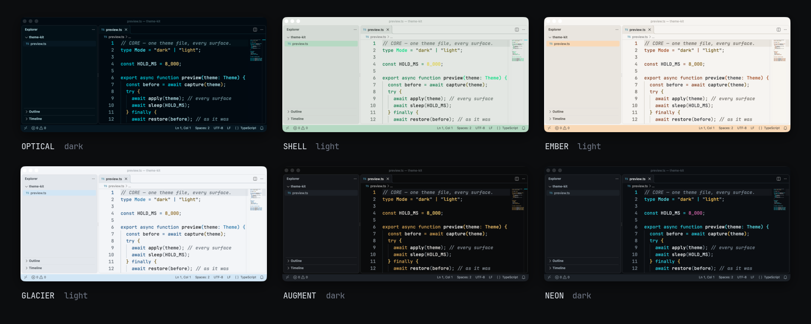
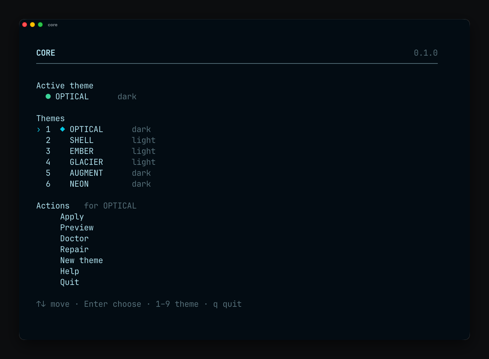

# CORE

**Universal visual themes for macOS.** Define a theme once, then preview or apply
it across your terminal, editor, AI tools and notes.

<p align="center">
  <a href="docs/media/core-preview.mp4"></a>
</p>
<p align="center"><sub><code>core</code> → Preview SHELL → every app switches → Enter → everything is back to OPTICAL. <a href="docs/media/core-preview.mp4">MP4</a></sub></p>

```
themes/optical/theme.toml  ──►  core apply optical  ──►  Ghostty · Terminal · Starship · Fastfetch
   one file per theme                                     VS Code · Hermes · Obsidian
                                                          ChatGPT (import) · macOS light/dark (opt-in)
```

- **One file per theme.** Colours, what they mean, and how each app uses them, in one TOML document.
- **Preview before you commit.** `core preview shell` changes your apps; Enter puts everything back.
- **All-or-nothing apply.** If anything fails or you press Ctrl-C, every app is rolled back.
- **Repairable.** When an app update removes CORE's files, `core repair` restores them.
- **Partial setups are normal.** Only Ghostty and VS Code? CORE themes those two. Apps you don't have are skipped.

<table>
  <tr>
    <td width="50%"></td>
    <td width="50%"></td>
  </tr>
  <tr>
    <td align="center"><sub>OPTICAL</sub></td>
    <td align="center"><sub>SHELL</sub></td>
  </tr>
</table>

## Supported applications

| Application | Apply | Preview | Repair | Notes |
| --- | :-: | :-: | :-: | --- |
| Ghostty | ✓ | ✓ | ✓ | Reloads running windows automatically |
| macOS Terminal | ✓ | ✓ | ✓ | Adds a `CORE <THEME>` profile and makes it the default; open tabs switch live |
| Starship | ✓ | ✓ | ✓ | Writes `~/.config/starship.toml` |
| Fastfetch | ✓ | ✓ | ✓ | Writes `~/.config/fastfetch/config.jsonc` |
| VS Code | ✓ | ✓ | ✓ | One small CORE base extension, then colours apply live through settings |
| Hermes (CLI and Desktop) | ✓ | ✓ | ✓ | A skin with `customCSS`, so text selection follows the theme too |
| Obsidian | ✓ | ✓ | ✓ | Every registered vault; open vaults switch live through Obsidian's CLI |
| ChatGPT | export | — | — | `core export <theme> chatgpt --copy`, then Settings → Appearance → Import |
| macOS appearance | opt-in | opt-in | — | Light/dark, only when you ask for it |
| Claude Desktop | — | — | — | Follows macOS when set to *Match System* (see notes) |

Each of these was verified against the real application on macOS, not only against config files.

## Built-in themes

| Theme | Mode | Character |
| --- | --- | --- |
| `optical` | dark | blue-black petroleum, ice text, cyan signal |
| `shell` | light | pale ceramic, graphite text, green signal |
| `ember` | light | warm white, burnt-orange signal |
| `glacier` | light | cool white, deep blue signal |
| `augment` | dark | charcoal and black glass, restrained gold |
| `neon` | dark | charcoal, electric cyan, vivid yellow |



## Install

You need macOS and Python 3.11 or newer. macOS ships Python 3.9; if you need a
newer one, `brew install python@3.12` (or any other installer) works.

```sh
git clone https://github.com/rtmandreyev/CORE.git ~/core
~/core/install.sh        # links ~/.local/bin/core; tells you if PATH needs a line
core doctor              # read-only: what CORE sees on this Mac
```

`install.sh` only creates the `~/.local/bin/core` link. It never edits your shell
configuration. CORE has no dependencies, and none of the supported apps is required.
Run it from Terminal, Ghostty or any other terminal.

## Quick start

```sh
core                     # the interactive app
core list                # themes
core preview shell       # try a theme; press Enter to restore everything
core apply optical       # keep a theme
core apply shell vscode  # only some apps
core status              # what is active where
```

## The interactive app

Run `core` with no arguments:



- Pick a theme with `1`–`9` or the arrow keys and Enter.
- **Apply** and **Preview** ask whether to use *All available applications* or
  *Select applications…*. The selection list shows each app's state (`READY`,
  `ACTIVE`, `N/A`, …). `Space` toggles an app, `a`/`n` select all or none, and
  Enter runs the change.
- **Doctor** shows the read-only diagnosis.
- **Repair** shows a dry run first and asks before changing anything.
- **New theme** creates a theme from the selected one.
- `Esc` goes back. `q` quits. `Ctrl-C` returns to the home screen, then quits.

Every action runs the same code as the one-shot commands.

## Preview vs apply

`core preview <theme>` captures the current state of each app, applies the
theme, and waits. Press Enter (or Ctrl-C, or close the terminal) and CORE
restores exactly what was there, then checks that it did.

`core apply <theme>` keeps the theme. It checks every app first and stops before
writing anything if one can't be changed safely. It writes a recovery journal,
applies, then verifies. If anything goes wrong it rolls everything back. If the
process is killed outright, `core restore` finishes the rollback from the journal.

Add `--dry-run` to either command to see the plan without changing anything.

## Create your own theme

```sh
core theme new solar --from shell     # creates themes/solar/theme.toml
$EDITOR themes/solar/theme.toml       # the only file you edit
core build solar                      # optional: compile and check it
core preview solar
core apply solar
```

The file has a few sections:

```toml
[theme]
id = "solar"
name = "SOLAR"
mode = "light"                  # light or dark

[palette]                       # which colours exist
paper = "#F4F1E8"
ink = "#1D1B16"
sun = "#C2410C"

[roles]                         # what they mean
background = "paper"
text = "ink"
signal = "sun"
selection = "#F7D9C4"

[terminal]                      # foreground, background, cursor, selection
[terminal.ansi]                 # the 16 ANSI colours
[prompt]                        # Starship
[apps.vscode]                   # how each app uses the roles, where it needs to
```

Start from a built-in theme: its file contains every key. App tables only say
where an app differs from CORE's defaults. Application templates are shared CORE
code, so you never copy or edit them, and you never touch Python. Output goes to
`build/`, which is disposable. To share a theme, share its `theme.toml`.

More in [docs/themes.md](docs/themes.md).

## Doctor and repair

```sh
core doctor              # read-only diagnosis of every app
core repair --dry-run    # what would be repaired
core repair              # restore CORE's own files
core repair hermes       # one app (also: ghostty, terminal, vscode, obsidian, starship, fastfetch)
```

Repair only restores what CORE owns: a skin file, a theme file, the VS Code base
extension, a Terminal profile, a vault's theme folder. It never changes which
theme an app uses, and `core apply` runs the same repair first when it's needed.

Example: a Hermes update removes CORE's skin. `core doctor` reports `REPAIRABLE`,
`core repair hermes --dry-run` shows the plan, `core repair hermes` restores the
skin, and running Hermes picks it up immediately. A second repair does nothing.

## Application notes

- **Ghostty.** CORE writes its `theme =` line into the config file Ghostty reads
  last and asks running Ghostty to reload.
- **Terminal.** CORE profiles (`CORE OPTICAL`, …) stay installed after you switch
  away or restore. They are ordinary profiles you can keep, reuse or delete.
- **VS Code.** The first apply installs the `core.core-base` extension with
  VS Code's own `code` command. VS Code may ask for one window reload the first
  time. After that, theme changes apply live through settings and never add
  extensions. CORE edits only its own settings keys and leaves comments and
  other settings alone.
- **Hermes.** CORE writes a skin and selects it, and Hermes Desktop picks it up
  live. The skin's `customCSS` sets text-selection colours. The built-in terminal
  pane draws its own selection and keeps it.
- **Obsidian.** CORE themes every registered vault Obsidian has opened at least
  once. Open vaults switch live when Obsidian's CLI is enabled (*Settings →
  General → Advanced → Command line interface*). Otherwise vaults show the theme
  the next time you open them. A vault created later is picked up the next time
  you run CORE. The vault chooser window can't be themed.
- **ChatGPT.** Export and import is supported and verified.
  `core export optical chatgpt --copy` puts ChatGPT's own theme-share string on
  your clipboard. Import it under *Settings → Appearance → Import* while ChatGPT
  is in the same light/dark mode as the theme. CORE never edits ChatGPT's settings.
- **macOS appearance.** Never changed unless you ask: `core apply optical macos`,
  or set `[surfaces] macos = true` in `~/.config/core/config.toml`.
- **Claude Desktop.** Claude's colour mode, interface font and code theme are
  kept inside Claude, with no supported way to set them from outside, so CORE
  doesn't. Set *Color mode* to *Match System*; CORE's macOS appearance option
  then switches Claude between light and dark.

## Safety

- Before any change, every app is checked and its current state is captured.
- Preview and apply write a recovery journal before the first change.
- Failures and Ctrl-C roll back. `core restore` handles anything left over.
- `core doctor`, `core status` and every `--dry-run` never write.
- No `sudo`, no package installs, no changes to application bundles, no
  injected scripts.
- The test suite cannot reach your real apps: it runs in a sandbox that blocks
  every external program and fails if a real file changes.

## Stop using CORE

There is no uninstall command, because CORE can't know which theme you want to
end up with. To stop:

1. Switch each app to the theme you want, in the app itself or with
   `core apply <theme>`.
2. Optionally delete CORE's files:
   - `~/.config/ghostty/themes/node-*` and `core-*`
   - `~/.hermes/skins/node-*.yaml` and `core-*.yaml`
   - `CORE - *` folders in each vault's `.obsidian/themes`
   - `CORE …` profiles in Terminal's settings
   - the `core.core-base` extension in VS Code
3. `rm ~/.local/bin/core`, delete `~/.config/core/` and delete the repository.
   Installed files are copies, so nothing breaks.

## Documentation

- [docs/commands.md](docs/commands.md): every command, states and exit codes
- [docs/themes.md](docs/themes.md): writing a theme
- [docs/architecture.md](docs/architecture.md): how CORE works, app by app
- [CHANGELOG.md](CHANGELOG.md) and [release notes](docs/releases/v0.1.0.md)

## Contributing

See [CONTRIBUTING.md](CONTRIBUTING.md). Run the tests with
`python3 -m unittest discover -s tests -t .`.

## License

[MIT](LICENSE). The licence covers CORE itself, not the applications it configures.
